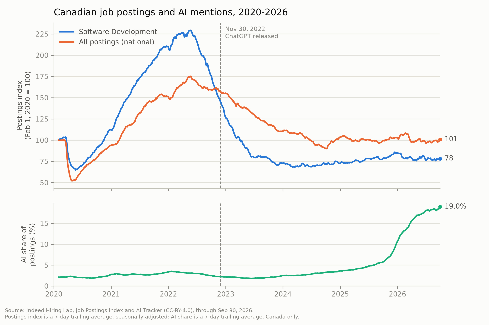
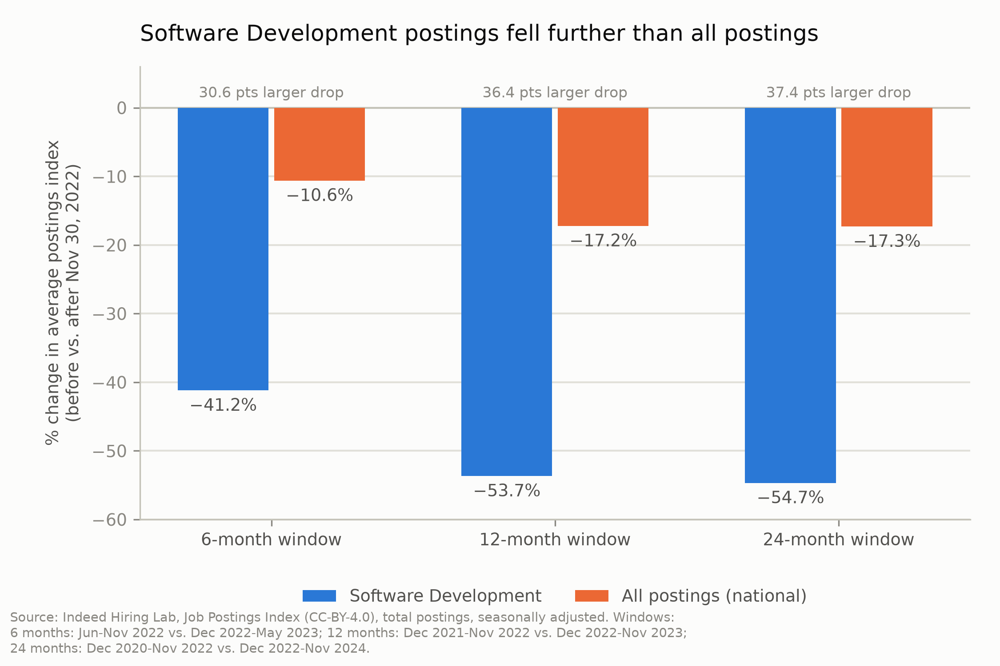
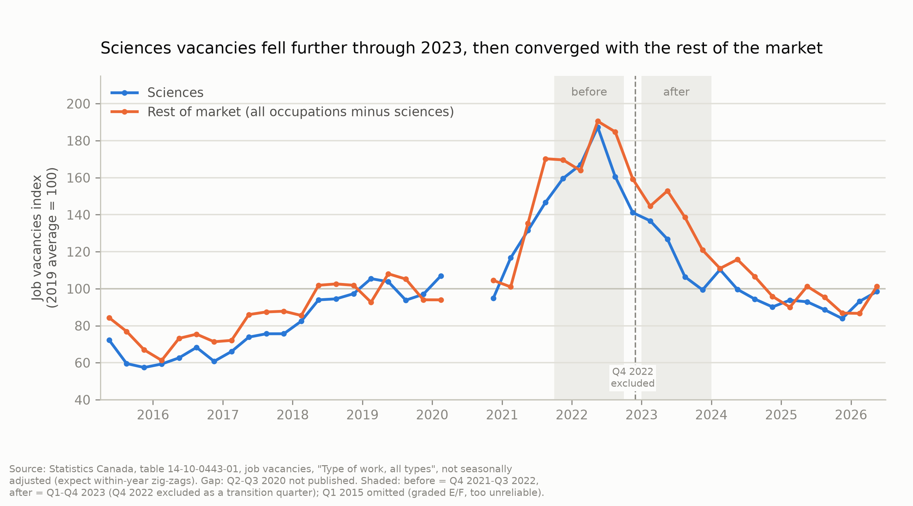

# Software Jobs Fell Before AI Took Off: A Timing Test of Generative AI's Effect on Canadian Tech Hiring

**Axay Mehta**
November 2026

## Abstract

Did Canadian software job demand change after generative AI went mainstream? This paper compares Indeed Hiring Lab's postings index and Statistics Canada's vacancy data before and after ChatGPT's Nov 30, 2022 release. Canadian Software Development postings fell 53.7% in the 12 months after the cutoff, versus 17.2% for all postings — a divergence Statistics Canada's vacancy data confirms independently (sciences occupations down 30.4% versus 21.4% for the rest of the market). But the timing argues against pinning this on AI specifically: software postings peaked and were already falling six months before ChatGPT existed, and AI mentions in postings stayed flat through 2023, rising only gradually until a sharp increase in late 2025. The two sources also disagree on persistence — Statistics Canada's gap closed by 2024, Indeed's has not. This design establishes a correlation in timing, not a causal estimate, and surfaces a methodological finding of its own: the AI-mentions series used here has been revised upward in every version checked since mid-2025.

## 1. Introduction

Did demand for Canadian tech workers change after generative AI went mainstream? This paper answers that by comparing Canadian software job postings and occupational vacancies before and after Nov 30, 2022 — the day OpenAI released ChatGPT and, with it, the moment generative AI went from a specialist technology to something tens of millions of people used directly (Section 4 gives the adoption figures).

The question matters for Canadian workforce and training policy because the evidence on AI's labour-market effects is still thin, and the data needed to test it rigorously — at the occupation level, under a stable methodology — largely doesn't exist yet in Canada (a gap this paper documents in Section 5.4 and returns to in Section 7). In the meantime, the question can still be asked with the public data that does exist, as long as its limits are stated plainly.

The answer, in short: Canadian software postings fell far more than overall postings after the cutoff — 53.7% versus 17.2% over 12 months, confirmed independently in Statistics Canada's vacancy data. But the timing does not support generative AI as the main cause: postings peaked and were already declining by May 2022, six months before ChatGPT existed, and the share of postings mentioning AI stayed flat through 2023, rising only gradually until a sharp increase in late 2025. A decline that starts before its proposed cause, paired with a cause that barely moves until the decline is well underway, favors other explanations (Section 6) over an AI-specific story, at least initially.

This paper's contribution is not a causal estimate; the design doesn't support one. It is a cross-check of two independent sources that agree on direction but diverge on persistence (Section 5.3), plus a documented finding that the AI-mentions series itself has been revised upward in every version checked since mid-2025 (Section 5.4) — a data-quality issue relevant to anyone else using this series.

## 2. Background

Three things were already reshaping Canadian tech hiring before generative AI entered the picture. First, the pandemic-era hiring boom: Canadian job postings, especially software postings, rose sharply through 2020–2022 as remote work and accelerated digital adoption pulled hiring forward (Section 5.1: Software Development's index peaked at 229.3 on May 23, 2022). A run-up that size creates its own mechanical aftermath — some unwinding was close to guaranteed regardless of what happened next.

Second, monetary policy: the Bank of Canada raised its policy rate from 0.25% to roughly 5% between March 2022 and mid-2023, a tightening cycle that raised the cost of capital for growth-stage tech firms and overlaps closely with the period this paper studies.

Third, the layoff wave that followed: major tech employers, including large multinationals with a significant Canadian presence, cut substantial numbers of jobs through 2022–2024 — widely reported, though not independently verified or sized here, and treated only as a plausible contributing factor (Section 6).

## 3. Data

This paper draws on two public sources: Indeed Hiring Lab, via its job-postings and AI-mention trackers, and Statistics Canada, via two tables on occupational employment and vacancies.

**Table 1.** Data sources used in this paper.

| Source | What it measures | Frequency | Coverage | Licence | Downloaded |
| --- | --- | --- | --- | --- | --- |
| Indeed Hiring Lab, Job Postings Index (Software Development sector and national aggregate) | Seasonally adjusted postings index, Canada (index = 100 on Feb 1, 2020) | Daily, 7-day trailing average | Feb 1, 2020 – Oct 30, 2026 | CC-BY-4.0 | Nov 10, 2026 |
| Indeed Hiring Lab, AI Tracker | Share of postings mentioning AI-related terms, Canada | Daily, 7-day trailing average | Jan 1, 2019 – Sep 30, 2026 | CC-BY-4.0 | Nov 10, 2026 |
| Statistics Canada, Table 14-10-0443-01 | Job vacancies, all occupations and Natural & applied sciences (NOC broad category 2) | Quarterly, not seasonally adjusted | Q1 2015 – Q2 2026 | Statistics Canada Open Licence | Nov 10, 2026 |
| Statistics Canada, Table 14-10-0416-01 | Employment by occupation (NOC 2021) | Annual | 2015–2025 | Statistics Canada Open Licence | Nov 10, 2026 |

Two definitions matter here. Indeed's postings series are an *index*, not a count: both are set to 100 on Feb 1, 2020, so a value of 78 means postings sit 22% below that baseline, not a count of ads. And "Software Development" is Indeed's own job-title-based sector, not Statistics Canada's NOC, whose closest matches — "Natural and applied sciences and related occupations" (vacancies) and "Professional occupations in applied sciences, except engineering" (employment) — are considerably broader, also covering engineers and scientists. The two sources are a directional cross-check, not a like-for-like match.

A few data-quality caveats carry through: 7 of Indeed's 47 sectors (including two of the three *supporting* sectors in Section 5.2) lack a matching job-title example[^1]; Statistics Canada's vacancies table isn't seasonally adjusted, so quarters are compared year-over-year; Q2–Q3 2020 is missing (pandemic disruption); and Q1 2015 is graded E/F, so that analysis starts at Q2 2015.

Full source links and further notes are in [`data/DATA_LOG.md`](../data/DATA_LOG.md).

[^1]: `job_postings_by_sector_CA_2026-11-10.csv` and `sector-job-title-examples_2026-11-10.csv`; see `data/DATA_LOG.md` for the full list of mismatched sector names.

## 4. Method

Every comparison here uses a single cutoff: November 30, 2022, the day OpenAI released ChatGPT — chosen not because the technology was new, but because this is when it became a mainstream product. OpenAI CEO Sam Altman reported one million users within five days, a self-reported figure with no independent count to confirm it (Altman 2022); independently, a UBS note reported by Reuters put it at roughly 100 million monthly active users by January 2023, the fastest-growing consumer app on record at the time (Hu 2023). That speed of adoption is why this date, not an arbitrary one, marks the before/after split used throughout.

The headline window is 12 months on each side of the cutoff, with 6- and 24-month windows as robustness checks — all three move the same direction (Section 5.2). For Statistics Canada's quarterly data, four quarters before (Q4 2021–Q3 2022) are compared against four after (Q1–Q4 2023), with Q4 2022 excluded as a transition quarter. Each comparison reports the percentage change in average level and the gap against a baseline; Statistics Canada also gets a "rest of market" baseline that nets the tech category out (Indeed's index, a relative measure rather than a count, can't be netted the same way). Indeed's index is also fixed at 100 on Feb 1, 2020, giving a pre-pandemic anchor independent of how high the "before" window sat during the boom (Section 5.2).

This is a before/after comparison on aggregate time series, not a controlled experiment — there is no counterfactual Canada without ChatGPT, and other things changed at the same time (Section 6). It can show whether software hiring diverged around the cutoff and whether that holds across sources and window choices; it cannot, on its own, attribute that divergence to generative AI specifically.

## 5. Results

### 5.1 Timeline (Fig 1)

*Top panel: Indeed postings index (Feb 1, 2020 = 100), Software Development vs. all postings (national), Nov 30, 2022 marked. Bottom panel: AI-mentions share of postings, Canada, same timeline.*

The AI-mentions share stayed flat at roughly 2% through 2023, then rose gradually through 2024 and most of 2025 (about 3.6% by Dec 2024, 5.7% by Sep 2025) before increasing sharply from late 2025 — a lag that argues against AI driving the initial postings drop (part of this late rise is also a measurement artifact; Section 5.4). This series is also country-wide, not sector-specific, so it can't show AI mentions are concentrated in software postings themselves.

Software Development peaked at 229.3 on May 23, 2022 — months before the cutoff — while the national series peaks lower and declines more slowly, so a gap opens before the cutoff and widens after. By Sep 30, 2026, Software Development sits at 78.2 (22% below its Feb 2020 baseline) versus 100.8 for all postings — a gap in level, quantified in Section 5.2 — while the AI-mentions share, near 2% through 2023, has risen to roughly 19% (read with caution; Section 5.4).

### 5.2 Before and after (Fig 2)

*% change in average postings index, before vs. after Nov 30, 2022, at 6/12/24-month windows.*

"Before"/"after" mean the N full calendar months around Nov 30, 2022 (e.g., 12-month: Dec 2021–Nov 2022 vs. Dec 2022–Nov 2023).

**Table 2.** Average postings index change, before vs. after the cutoff, by window.

| Window | Software Development | All postings (national) | Gap |
| --- | --- | --- | --- |
| 6 months | -41.2% | -10.6% | -30.6 pts |
| 12 months | -53.7% | -17.2% | -36.4 pts |
| 24 months | -54.7% | -17.3% | -37.4 pts |

Supporting sectors, 12-month window: Data & Analytics -46.8%, IT Systems & Solutions -39.6%, IT Infrastructure/Operations & Support -34.0% — all between Software Development and the -17.2% baseline, though two of three lack job-title documentation to confirm coverage (Section 3).

Most of the divergence happens within the first year: the gap widens 5.8 points from 6 to 12 months but only 1.0 further from 12 to 24. The pre-pandemic framing sharpens this — in year one, software averaged 94.3 (already below its 100 baseline) while all postings averaged 134.0 (still well above theirs); by the latest data, the national series has drifted back near baseline (100.8) while software remains well below its pre-pandemic level (78.2, after bottoming at 68.1 in March 2024 and partly recovering since). Software has not recovered; the market around it has. Two caveats limit this: the "before" window includes the pandemic-boom peak (Section 5.1), so part of the drop is that unwinding; and the national baseline includes Software Development itself and can't be netted out the way Section 5.3 nets sciences out — if anything understating the true gap.

### 5.3 Statistics Canada cross-check (Fig 3)

*Quarterly job vacancies index (2019 average = 100), Natural & applied sciences vs. rest of the market (all occupations minus sciences), Q2 2015 - Q2 2026.*

Comparing Q4 2021–Q3 2022 to Q1–Q4 2023 (Q4 2022 excluded as a transition quarter): sciences vacancies fell 30.4% vs. 21.4% for the rest of the market (sciences are only about 7.8% of total vacancies, so this baseline and the unadjusted "all occupations" baseline tell almost the same story). But the gap isn't constant: it opens in Q3 2022 — before the cutoff — troughs at -32 points in Q3 2023, narrows sharply from Q1 2024, and has stayed within about ±9 points since late 2024, with both series back near their 2019 baseline. This is a temporary divergence bracketing the cutoff, not a structural break, and it means the two sources disagree on persistence: Indeed's software gap (Section 5.2) never closes, while Statistics Canada's does within about a year. Two likely reasons, rather than one source being wrong: the StatCan category is far broader than software alone, so a recovery elsewhere in sciences could mask continued software-specific weakness; and postings and vacancies are different things that needn't move together even for the same occupations.

A third, descriptive data point agrees in direction: Statistics Canada's employment table shows "Professional occupations in applied sciences (except engineering)" fell 1.1% from 2022 to 2023 while all occupations grew 3.0%. This isn't an independent confirmation — employment lags postings and vacancies by construction — but it's consistent with the same divergence eventually showing up in who is actually working.

### 5.4 The AI share and its revisions

The AI-mentions share in Fig. 1 isn't a stable measurement — in every version checked since mid-2025, the historical series has only ever been revised upward, never down, and more so for recent dates:

**Table 3.** Canada AI-mentions share for selected dates, across four AI Tracker snapshots checked.

| Canada AI share for... | Jun 2025 | Aug 2025 | Dec 2025 | Oct 2026 snapshot[^2] | Total revision |
| --- | --- | --- | --- | --- | --- |
| Nov 30, 2022 | 2.19% | 2.19% | 2.21% | 2.22% | +1% |
| Nov 30, 2023 | 2.20% | 2.20% | 2.23% | 2.27% | +3% |
| Nov 30, 2024 | 3.09% | 3.09% | 3.25% | 3.41% | +10% |
| Nov 30, 2025 | — | — | 5.86% | 8.01% | +37%* |

*\*Nov 30, 2025 wasn't yet in the Jun/Aug 2025 snapshots, so its "total revision" compares the Dec 2025 and Oct 2026 columns, not Jun 2025 like the rows above.*

This lines up with a [pull request](https://github.com/hiring-lab/ai-tracker/pull/4) merged Aug 15, 2025, removing the separate `GenAI_posting.csv` file that tracked generative-AI keywords apart from broader AI keywords; the repo's schema still lists that file though it's gone (Indeed Hiring Lab, AI Tracker, 2026; checked directly against the repository, not inferred from commit timing). Those keywords were likely folded into the remaining series, with history restated under the broader definition each release — consistent with 2022–2023 barely moving while 2024–2025 was revised far more.

The flat 2023 period is stable across every version checked, so the Section 5.1 timing argument doesn't depend on which release is used. The 2025–26 rise is real but its steepness partly reflects download timing, not purely demand; the before/after analysis doesn't use this series, so this affects only how Fig. 1 is described.

[^2]: The Oct 2026 snapshot is the version closest to this paper's Nov 10, 2026 data download, and is what Fig. 1 and the numbers quoted in Section 5.1 are drawn from.

## 6. Limitations and alternative explanations

This paper's design — before/after averages on aggregate time series — documents a correlation in timing, not a cause. Several other things happened in the same window, and the timing evidence in Sections 5.1–5.2 favors some of them over an AI story specifically.

**The pandemic hiring boom was unwinding anyway** (Section 5.1) — the May 2022 peak predates ChatGPT by six months, so part of the drop is that boom unwinding on its own timeline, no AI story required.

**Macro shocks moved on almost the same timeline** (Section 2) — the Bank of Canada's 2022–23 rate hikes and the 2022–2024 tech-layoff wave are each at least as plausible a driver as generative AI, and this paper makes no attempt to separate any of them.

**Immigration and labour-supply shifts are not separated out** — a fall in postings or vacancies can reflect less demand, more available supply, or both.

**Neither the baselines nor the data are clean controls**: Indeed's national baseline includes Software Development itself and can't be netted the way Section 5.3 nets sciences out, likely understating the true gap; and the data has its own limits — an index rather than a count (Section 3), a broad NOC category that can dilute a software-specific signal (Section 5.3), and an AI-mentions series revised across releases (Section 5.4).

**What would test an AI effect more directly.** Three kinds of evidence would get closer to a causal claim than aggregate time series can: occupation-level AI-exposure data compared against postings, to see whether more-exposed occupations fell further within the same sector; firm-level AI-adoption data matched to firm-level hiring, to isolate an AI effect from macro shocks hitting every tech firm at once; and a more detailed Statistics Canada occupation series (computer-and-information-systems vacancies, distinct from the broader sciences category) to directly test the dilution concern in Section 5.3 — one doesn't currently exist at a usable data-quality grade.

## 7. Policy implications

This paper's biggest actionable finding is about measurement, not AI's effect specifically. Section 5.4 showed Indeed's AI Tracker revised its historical AI-mentions share upward, in every version checked since mid-2025, following a definitional change never reflected in its published methodology. If Canada wants to measure AI's labour-market effect as it happens, it needs its own versioned AI-mention or AI-adoption data under a fixed methodology — e.g., a standing AI-exposure classification by occupation, or a direct question on employer AI tool use, added to Statistics Canada's existing vacancy and employment collection.

A narrower recommendation follows from Section 5.3's dilution problem: Statistics Canada's public vacancy breakdown stops at a broad "natural and applied sciences" category. A computer-and-information-systems-specific series, at a usable data-quality grade, would let a comparison like this one target actual software jobs rather than a broad proxy.

On the workforce side, the findings support caution rather than alarm: whatever the cause, Canadian software postings have not recovered to their pre-pandemic level more than three years after the cutoff (Section 5.2), while the broader market largely has — a real fact for new graduates and early-career workers regardless of why. But Section 6's confounders mean this doesn't support AI-targeted workforce programs ahead of the alternatives identified there; the more defensible response is fixing the measurement gap first, so future data can actually distinguish between these explanations.

## 8. Conclusion

Canadian software job postings fell far more than overall postings after Nov 30, 2022, and an independent Statistics Canada series shows the same broad pattern. But the timing argues against pinning this on AI specifically: postings peaked and began falling six months before ChatGPT's release, and AI mentions stayed flat through 2023, rising only gradually until a sharp increase in late 2025 — the pandemic boom unwinding and the Bank of Canada's rate hikes, on almost the same timeline, are at least as plausible drivers. The two sources also disagree on persistence: Statistics Canada's gap closed by early 2024, Indeed's has not. This design establishes correlation, not cause.

What would move this forward: occupation-level AI-exposure or AI-adoption data for Canada under a stable methodology, rather than the revised third-party series used here; and watching whether Indeed's gap eventually converges the way Statistics Canada's did, or stays open.

## References

Altman, Sam (@sama). Post on X (formerly Twitter), Dec 5, 2022. https://twitter.com/sama/status/1599668808285028353

Hu, Krystal. "ChatGPT Sets Record for Fastest-Growing User Base, Analyst Note." *Reuters*, Feb 1, 2023. https://www.reuters.com/technology/chatgpt-sets-record-fastest-growing-user-base-analyst-note-2023-02-01/

Indeed Hiring Lab. "AI Tracker." GitHub repository. https://github.com/hiring-lab/ai-tracker. Data accessed Nov 10, 2026; README/schema checked Nov 11, 2026. CC-BY-4.0.

Indeed Hiring Lab. "Job Postings Tracker." GitHub repository. https://github.com/hiring-lab/job_postings_tracker. Accessed Nov 10, 2026. CC-BY-4.0.

Statistics Canada. Table 14-10-0416-01. "Labour force characteristics by occupation, annual." https://www150.statcan.gc.ca/t1/tbl1/en/tv.action?pid=1410041601. Accessed Nov 10, 2026. Statistics Canada Open Licence.

Statistics Canada. Table 14-10-0443-01. "Job vacancies, proportion of job vacancies and average offered hourly wage by occupation and selected characteristics, quarterly, unadjusted for seasonality." https://www150.statcan.gc.ca/t1/tbl1/en/tv.action?pid=1410044301. Accessed Nov 10, 2026. Statistics Canada Open Licence.

## Appendix

### Repo and reproduction

Code, data, and figures: https://github.com/axaym/python/tree/main/canada-tech-jobs-ai. To reproduce: `pip install -r requirements.txt`, then run `src/01_clean.py`, `src/02_analysis.py`, and `src/03_figures.py` in order (see the repo's `README.md` for what each step produces). A glossary of terms used in this paper (seasonally adjusted, index vs. count, NOC, etc.) is at `GLOSSARY.md` in the repo.

### AI-use note

Claude helped plan the study, suggested data sources and methods, and helped write and review code. Claude drafted parts of the text from my outline and analysis; I edited and checked every claim against the data.
